# 생활달력 사용 설명서

처음 켜는 분을 위한 5분 가이드 — 대상 만들기부터 알림 받기까지. *(v0.7 · UX 2.0 기준)*

이 앱은 집·자동차·카드·가족처럼 **반복해서 챙겨야 하는 일**(정수기 필터 교체, 자동차보험 갱신, 카드 실적, 생일…)을 등록해 두면 **다음 날짜를 알아서 계산**해서 홈에 D-day로 보여주고, 날짜가 다가오면 알림으로 알려주는 앱이에요. 아래 순서 그대로 따라 하면 5분 안에 첫 알림을 걸어 둘 수 있어요.

## 이 앱이 다른 앱과 다른 점

| | |
|---|---|
| **내 폰 안에만 저장돼요** | 계정도, 서버도, 광고도 없어요. 앱에는 인터넷 권한 자체가 없어서 등록한 내용이 폰 밖으로 나가지 않아요. |
| **다음 날짜를 알아서 계산해요** | "6개월마다", "매달 25일", "매년 음력 3월 5일"처럼 주기를 한 번 정해 두면, 일을 마칠 때마다 다음 날짜가 자동으로 넘어가요. |
| **알아둘 점 — 백업은 직접 해야 해요** | 앱을 지우거나 폰을 바꾸면 기록이 같이 사라져요(구글 자동 백업도 꺼져 있어요). **설정 → 백업 파일 만들기**로 가끔 파일을 만들어 두세요. 영수증 사진은 백업 파일에 들어가지 않아요. |

## 0. 설치하기

1. [릴리즈 페이지](https://github.com/dayfly2u/k-home-note/releases/latest)의 **Assets**에서 `app-debug.apk` 파일을 폰에 다운로드해요. (안드로이드 8.0 이상에서 쓸 수 있어요.)
2. 파일을 눌렀을 때 "출처를 알 수 없는 앱" 경고가 뜨면 **설치 허용**을 눌러요 (앱스토어를 거치지 않고 직접 설치하는 파일이라 뜨는 정상적인 경고예요).
3. 설치가 끝나면 **생활달력** 아이콘을 눌러 실행해요. 알림 권한을 물어보면 **허용**해 주세요 — 챙길 날짜가 다가올 때 알림으로 알려주는 핵심 기능이에요.

> **TIP** 이전 버전 위에 그대로 덮어 설치하면 등록한 대상·작업·기록이 그대로 유지돼요. 업데이트 전에 아래 "0-1"대로 백업 파일을 한 번 만들어 두면 더 안심이에요.

### 0-1. 백업하고 복원하기

폰을 바꾸거나 앱을 다시 설치할 때를 위해, **백업 파일**을 만들어 두세요. 대상, 주기성작업, 일회성작업, 이력이 파일 하나에 통째로 들어가요.

1. **백업** — 아래 탭의 **설정**에서 **백업 파일 만들기**를 눌러요. 저장할 위치(예: 내 파일의 `Download` 폴더, 구글 드라이브)를 고르면 `k_home_note_backup_날짜_시간.db` 파일이 만들어지고, 그 줄에 **마지막 ○월 ○일**이 표시돼요.
2. **복원** — 새 폰이나 다시 설치한 앱에서 **설정 → 백업에서 복원**을 눌러 그 파일을 고르고, **"백업 파일로 복원할까요?"** 창에서 **복원**을 눌러요. 앱이 저절로 다시 켜지면서 예전 기록이 나타나요.

> **주의**
> - **복원은 "덮어쓰기"예요.** 지금 폰에 있는 내용이 전부 백업 파일 내용으로 바뀌고 되돌릴 수 없어요.
> - **앱을 삭제하면 폰 안의 기록이 모두 사라져요.** 백업 파일이 폰 밖(구글 드라이브, PC, 메신저의 "나에게 보내기" 등)에도 있는지 확인한 뒤에 삭제하세요.
> - **영수증 사진은 백업 파일에 들어가지 않아요.** 복원하면 사진 자리는 비어 있을 수 있어요. 기록(날짜·가격·구매처·메모)은 그대로 돌아와요.
> - 오래된 버전에서 만든 백업 파일도 복원할 수 있어요. 복원하고 앱이 다시 켜질 때 최신 구조로 자동으로 맞춰져요.

## 1. 먼저 알아둘 세 가지 말

| 말 | 뜻 | 예 |
|---|---|---|
| **대상** | 챙길 일이 달려 있는 물건·사람·계약 | 정수기, 자동차, 신한카드, 어머니 |
| **주기성작업** | 대상에 달린, **반복해서** 하는 일 | 필터 교체(4개월마다), 보험 갱신(매년), 생신(매년 음력) |
| **일회성작업** | 대상에 달린, **한 번만** 하는 일 | 보일러 점검 예약, 수리, 신청 마감 |

대상을 먼저 만들고, 그 안에 주기성작업과 일회성작업을 넣는 순서예요. 앱을 처음 켜면 **가전 · 자동차 · 카드** 카테고리가 기본으로 들어 있어요.

## 2. 대상 만들기

홈 오른쪽 위 **＋** 버튼을 누르고 **"새 대상 만들기"** 를 눌러요. (아래 탭 **모아보기**의 **"대상 추가"** 버튼으로도 만들 수 있어요.)

- **카테고리**를 골라요. 목록에 없으면 맨 아래 **"+ 새 카테고리"** 로 이모지와 이름을 직접 만들 수 있어요.
- **이름**을 적어요. (예: 다이슨 V15, 신한카드, 우리 가족)
- **메모**는 선택이에요. (예: 12가 3456 · 2023년 3월 출고)

저장하면 그 대상의 **상세 화면**으로 바로 이동해서 주기성작업을 이어서 추가할 수 있어요.

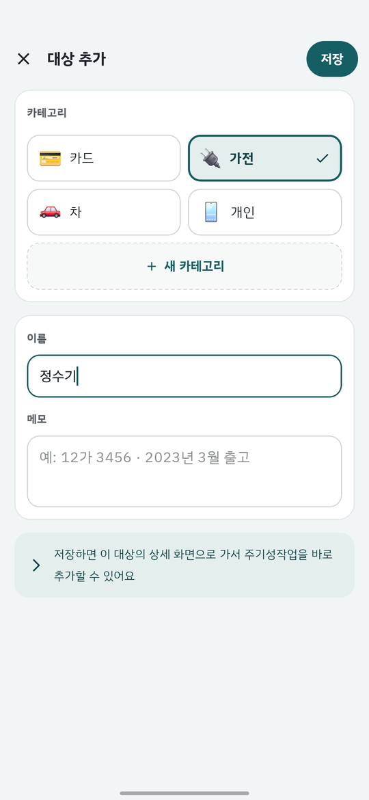

## 3. 주기성작업 추가하기

대상 상세 화면의 **주기성작업** 제목 오른쪽 **＋** 를 누르면 입력 화면이 열려요.

- **빠른 선택** — 맨 위 칩(생일 · 카드 실적 · 엔진오일 · 정수기 필터 · 에어컨 필터 · 자동차보험)을 누르면 이름·주기·알림이 한 번에 채워져요. 고쳐서 써도 돼요.
- **이름** — 예: 엔진오일 교체, 어머니 생신.
- **언제 돌아오나요** — 세 가지 중에서 골라요.
  - **기간마다** — "6개월마다"처럼 숫자와 단위(일 · 개월 · 년). 마지막으로 한 날부터 그 기간 뒤가 다음 날짜예요. 계산은 **한 달 = 30일, 한 해 = 365일** 기준이라, 4개월은 정확히 120일 뒤예요. 달력의 같은 날짜로 맞추고 싶다면 아래 "매달 / 매년"을 쓰세요.
  - **매달** — "매달 25일"처럼 날짜 고정. 그 달에 없는 날(예: 2월 30일)은 그 달의 마지막 날로 맞춰져요.
  - **매년** — "매년 3월 5일". **양력 / 음력**을 고를 수 있어서 음력 생일·제사도 그 해의 양력 날짜로 알아서 바꿔 줘요.
- **며칠 전부터 알려줄까요** — −/+ 로 정해요. 예를 들어 **14일**이면 **14일 전 · 7일 전 · 3일 전 · 1일 전** 이렇게 절반씩 줄여 가며 알려줘요. 0일이면 당일에만 알려줘요.
- **다음 날짜** — 위에서 정한 값으로 계산한 다음 날짜와 D-day를 미리 보여줘요. 맞는지 여기서 확인하고 저장하세요.
- **메모**는 선택이에요.

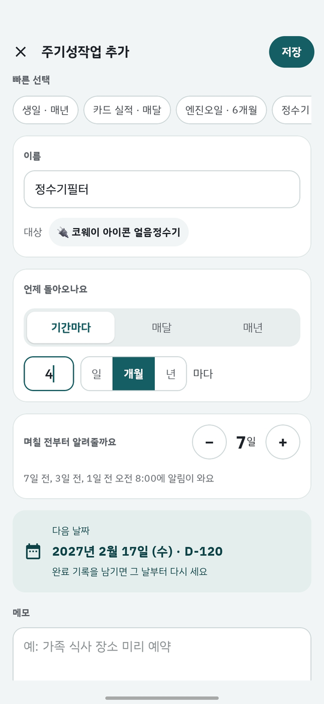

> **TIP** 아직 한 번도 안 한 일이라면 **등록한 날**부터 주기가 시작돼요. 이미 한 적이 있다면 등록한 뒤 **이력 기록**(아래 5번)으로 그 날짜를 남겨 두세요.

## 4. 홈 화면 읽기

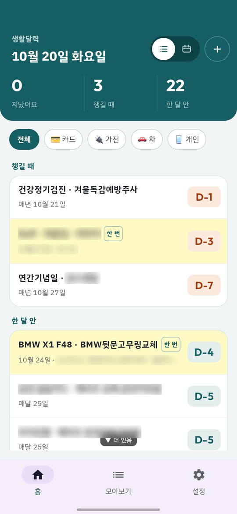

- **맨 위 요약 3칸** — **지났어요**(날짜가 지난 일) · **챙길 때**(알림 받기로 정한 기간에 들어온 일) · **한 달 안**. 칸을 누르면 목록에서 그 구간으로 바로 스크롤돼요.
- **구간별 카드** — 목록은 급한 순서로 **지났어요 → 챙길 때 → 한 달 안 → 석 달 안 → 나중에** 카드에 묶여 나와요. 줄마다 **"대상 · 작업 이름"**(예: 정수기 · 필터 교체), 그 아래 주기와 지난번 날짜, 오른쪽에 **D-day 배지**가 있어요. 급한 것만 주황색으로 눈에 띄고, 멀수록 흐려져요.
- **카테고리 칩** — 요약 아래 칩으로 가전·자동차·카드처럼 한 종류만 모아 볼 수 있어요.
- **연한 노랑 줄**(이름 옆에 **"한 번"** 태그)은 일회성작업이에요.

줄을 누르면 일을 마쳤다는 **기록**을 남기고(다음 5번), **꾹 누르면** 그 작업을 고칠 수 있어요.

| | 가볍게 누르기 | 꾹 누르기 |
|---|---|---|
| **주기성작업** | 이력 기록 시트 | 주기성작업 수정 화면 |
| **일회성작업** | "완료로 표시" 시트 | 일회성작업 수정 시트 |

### 달력으로 보기

헤더 오른쪽의 **목록 / 달력** 버튼으로 홈을 월간 달력으로 바꿀 수 있어요. 고른 보기는 앱을 껐다 켜도 기억돼요.

- 날짜 밑 **점**이 그날 챙길 일이 있다는 표시예요 (지남·알림 기간은 주황, 그 외는 청록). **일회성작업이 있는 날은 노란 원**으로 둘러싸요.
- 날짜를 누르면 아래에 **그날 작업**이 홈과 같은 줄로 나오고, 거기서도 똑같이 누르거나 꾹 눌러서 쓸 수 있어요. 카테고리 칩도 그대로 적용돼요.
- 달력에는 각 작업의 **다음 예정일 하나**만 찍혀요. 매달·매년 반복되는 일의 먼 미래 날짜까지 미리 깔아 주지는 않아요.

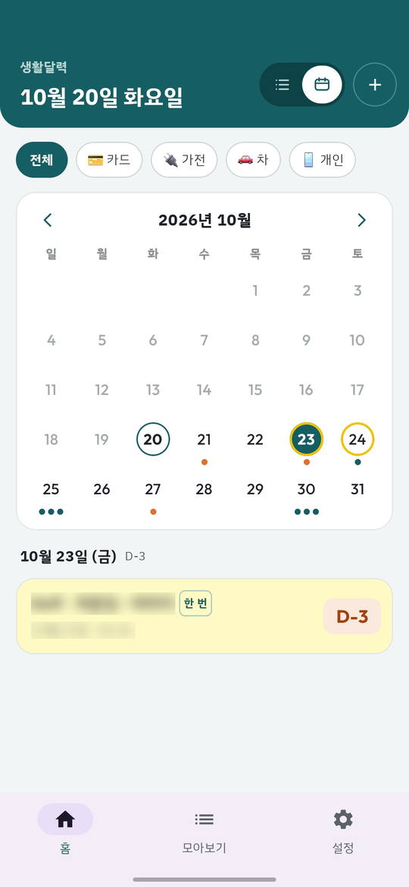

## 5. 일을 마치면 이력 기록하기

홈에서 **주기성작업 줄을 가볍게 누르면** 이력 기록 시트가 열려요. (대상 상세의 주기성작업을 열고 **이력 기록하기** 버튼을 눌러도 돼요.)

- **한 날**(기본은 오늘)과 **가격**을 정해요.
- **구매처/링크**를 적을 수 있어요. (예: 쿠팡, 다이소, 구매 링크)
- **영수증 사진** 버튼으로 사진을 골라 붙이고, **메모** 버튼을 누르면 메모 칸이 펼쳐져요. 모두 선택이에요.
- 시트 아래에 **"다음 예정일은 ○○로 넘어가요"** 가 미리 보여요. **이력 기록**을 누르면 그 날짜로 넘어가고 홈에서도 새 D-day로 바뀌어요.

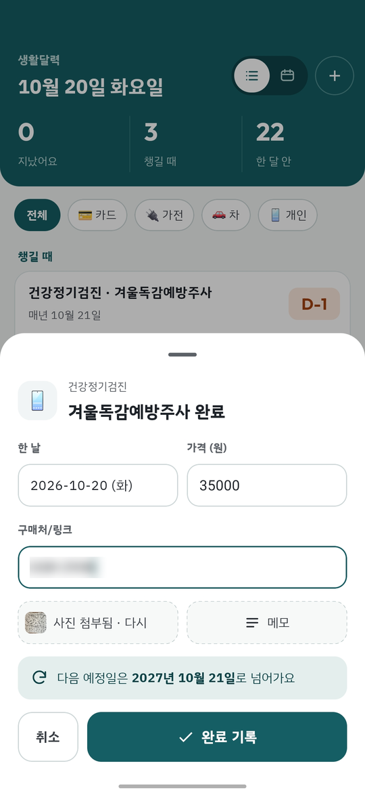

기록은 주기성작업 상세 화면의 **이력**에 쌓이고, 각 줄의 ⋮ 메뉴에서 고치거나 지울 수 있어요.

> **TIP** "6개월마다" 같은 기간 주기는 **마지막으로 한 날**에서 다시 6개월을 세요. 반대로 "매달 25일"처럼 날짜가 고정된 일은 며칠 일찍 하든 늦게 하든 **다음 25일**로 정확히 넘어가요.

## 6. 일회성작업 추가하고 끝내기

대상 상세 화면의 **일회성작업** 제목 오른쪽 **＋**, 또는 홈 **＋ → 대상 고르기 → 일회성작업 추가**로 열어요.

- **이름 · 날짜 · 가격 · 메모**를 적어요. 이미 끝낸 일을 기록만 해 둘 수도 있고, 앞으로 할 일의 예정일로 쓸 수도 있어요.
- **알림 받기** 스위치를 켜면 **며칠 전부터** 알려줄지 정할 수 있고, 홈에도 연한 노랑 줄로 나타나요. 끄면 **기록으로만** 남고 홈에는 보이지 않아요.

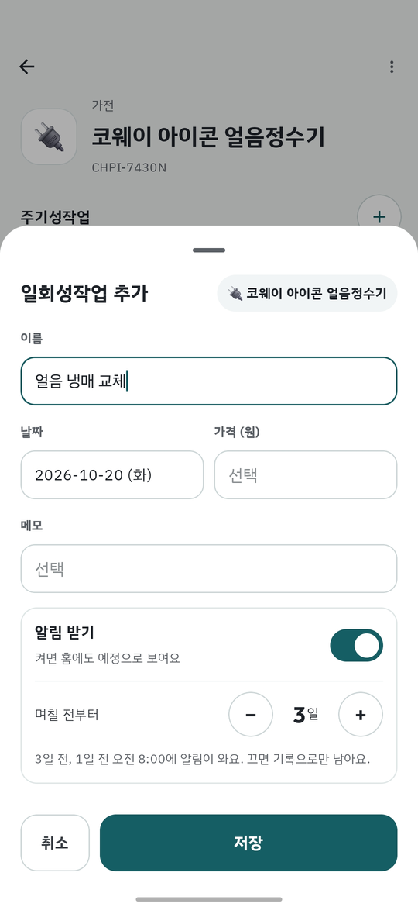

일을 마쳤으면 홈에서 그 줄을 **가볍게 눌러요**. **"OO, 끝났나요?"** 시트가 열려요.

- 실제로 **한 날 · 가격 · 구매처/링크 · 영수증 사진 · 메모**를 남기고 **완료로 표시**를 눌러요.
- 알림이 꺼지고 홈에서는 빠지지만, **대상 상세의 일회성작업 기록에는 그대로 남아요** (구매처와 사진 썸네일도 같이 보여요).
- 해마다 하는 일이었다면 시트의 **"매년 하는 일이면 주기성작업으로 바꾸기"** 를 눌러 이름이 채워진 주기성작업 추가 화면으로 넘어갈 수 있어요.

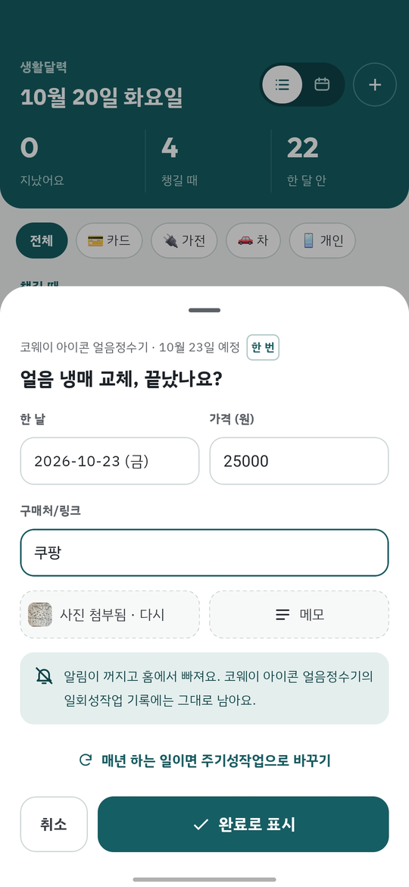

## 7. 대상 모아보기와 상세 화면

아래 탭 **모아보기**에는 대상이 카드로 나열돼요. 카드마다 **"주기성 N · 일회성 M"** 과 **가장 가까운 작업의 D-day**가 보이고, 오른쪽 **≡** 를 꾹 눌러 드래그하면 순서를 바꿔요. ⋯ 메뉴에서 대상을 **수정 / 삭제**할 수 있어요.

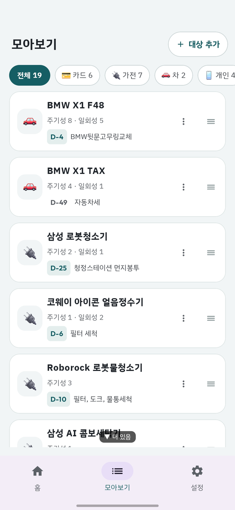

카드를 누르면 **대상 상세 화면**이에요.

- **주기성작업** 카드 — 줄마다 이름, 주기, 진행 막대, D-day 배지가 있어요. 줄을 누르면 주기성작업 상세, ≡ 로 순서 바꾸기, ⋮ 로 수정/삭제.
- **일회성작업** 카드 — 알림이 켜진 것은 `🔔 N일 전` 태그와 D-day 배지가 붙고, 가볍게 누르면 "완료로 표시"예요. 끝난 것은 날짜·가격·구매처·사진이 함께 보여요. 사진 썸네일을 누르면 크게 열려요.
- 오른쪽 위 ⋯ 메뉴에서 **대상 수정 / 대상 삭제**. 주기성작업이 남아 있는 대상은 지울 수 없고(먼저 주기성작업을 지워야 해요), 지울 때는 그 대상의 일회성작업 기록도 함께 지워진다는 확인 창이 떠요.

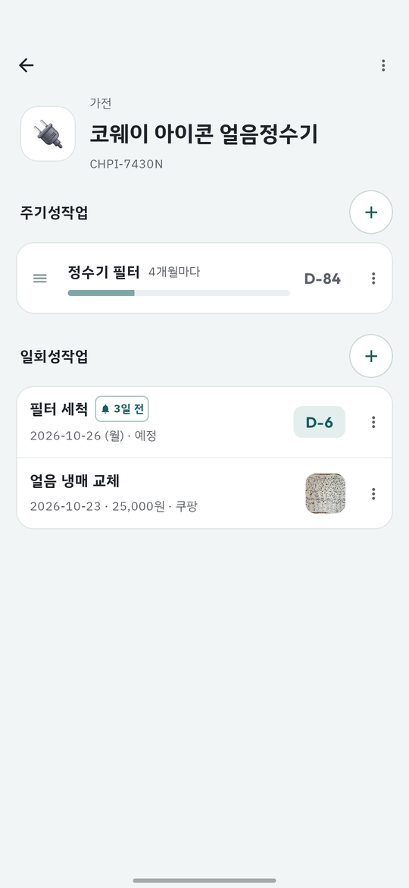

주기성작업을 누르면 **상세 화면**이 열려요. 진행 링과 D-day, 다음 예정일, 알림 시점이 맨 위에 있고, **기록 횟수 · 누적 비용 · 실제 평균 간격** 통계와 지금까지의 **이력**을 볼 수 있어요. "6개월마다"로 정했는데 실제로는 평균 7개월 간격이었다는 식으로 내 습관도 알 수 있어요.

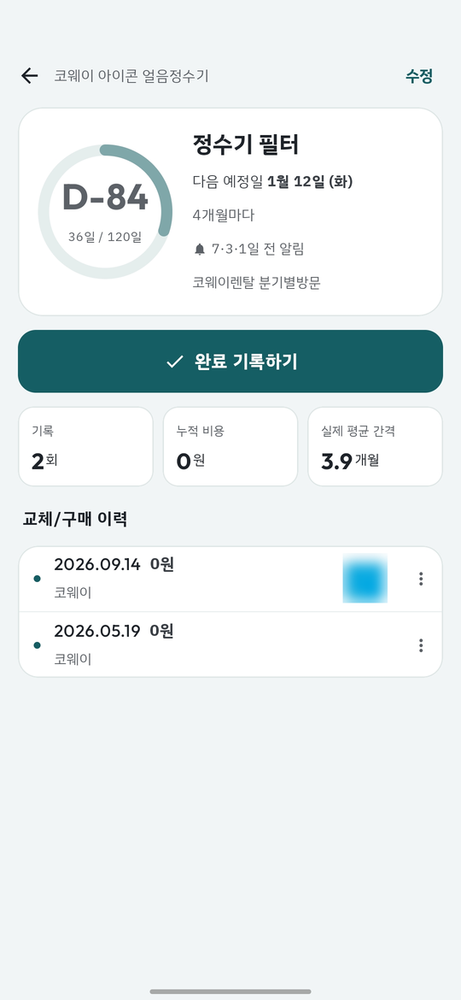

## 8. 설정

아래 탭 **설정**에서 세 가지를 다뤄요.

- **카테고리** — 줄을 누르면 이름·이모지를 고치거나 지울 수 있어요(쓰고 있는 대상이 있으면 지울 수 없어요). ≡ 를 꾹 눌러 순서를 바꾸고, 맨 아래 **"+ 카테고리 추가"** 로 새로 만들어요.
- **매일 알림 확인 시각** — 앱이 하루에 한 번 챙길 일을 확인해서 알림을 보내는 시각이에요. 기본은 **오전 8:00**이고, 눌러서 바꿀 수 있어요. 시각은 폰의 절전 상태에 따라 전후로 조금 달라질 수 있어요.
- **백업 파일 만들기 / 백업에서 복원** — 위 "0-1"을 참고하세요.

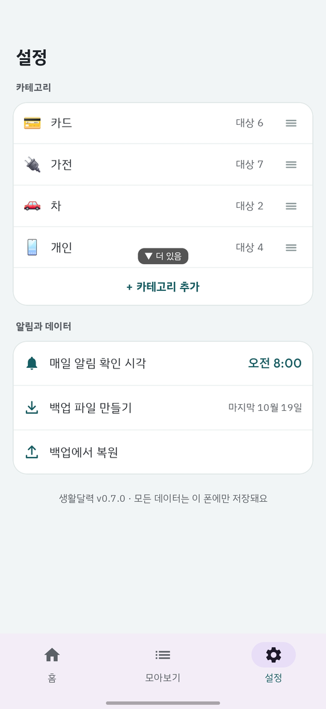

> **알림은 이렇게 와요** 알림 받기를 정한 일은, 위 시각에 앱이 확인했을 때 **알릴 시점**(예: 14·7·3·1일 전)이 되었으면 알림으로 알려줘요. 제목은 **"대상 · 작업 이름"** 이고, 주기성작업은 "○일 후 교체 예정이에요" / "오늘이 교체일이에요", 일회성작업은 "○일 후 예정된 일이에요" / "오늘 예정된 일이에요"라고 와요. 같은 시점은 한 번만, 한 번 확인할 때 작업마다 한 건씩 와서 알림이 몰리지 않아요. 알림이 안 오면 폰 **설정 → 앱 → 생활달력 → 알림**이 켜져 있는지 확인해 보세요.

---

처음엔 대상 하나(예: 정수기)와 주기성작업 하나(필터 교체)만 만들어 보는 걸 추천해요. 홈에 D-day가 뜨는 걸 한 번 보고 나면 나머지는 금방이에요.
